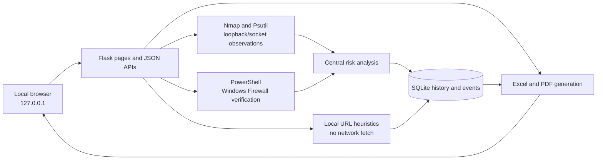
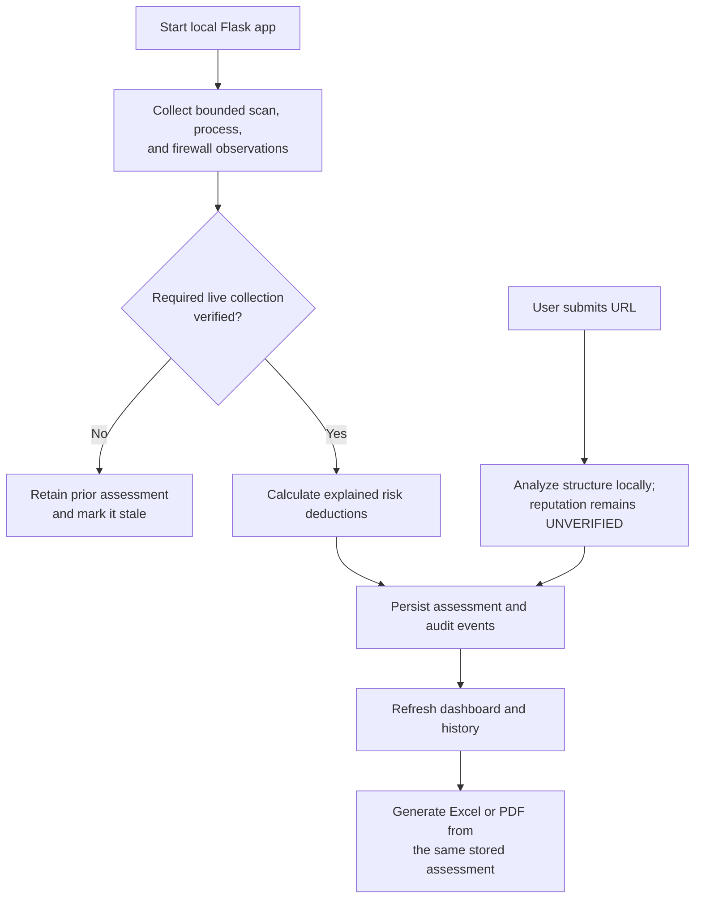

# Attack Surface Reduction Management System (ASRMS)

A standalone, local-first Windows security dashboard built with Flask. It
combines bounded Nmap port observations, Psutil listener/process inventory,
transparent exposure prioritization, confirmed Windows Firewall rules and
profile management, and SQLite-backed scan history and audit events.

The application binds to loopback and rejects non-loopback client and Host
requests. State-changing JSON APIs require a session CSRF token rendered into
the local UI. Keep this application on the local machine; do not expose it
through a public reverse proxy.

## Problem statement and objectives

Windows host exposure, process ownership, firewall state, and scan history are
often inspected in separate tools. ASRMS brings those observations together
without treating every listening socket as a vulnerability or every unknown
reputation as safe.

Project objectives:

- Provide a local dashboard for bounded TCP/UDP observations and process mapping.
- Verify Windows Firewall profile and application-rule state before reporting it.
- Explain risk deductions and distinguish verified findings from observations.
- Preserve assessment history and support comparable Excel/PDF exports.
- Analyze submitted URLs locally without fetching them or disclosing them to a
  third party.

## Technology stack

| Area | Technology |
|---|---|
| Application and API | Python, Flask |
| Persistence | SQLite |
| Local network observations | Nmap, Psutil |
| Windows Firewall | PowerShell NetSecurity cmdlets |
| Reports | pandas, openpyxl, Matplotlib PDF backend |
| Interface | Flask templates, HTML, CSS, JavaScript |

## Windows setup and startup

Open PowerShell in this folder. Use the existing `venv`:

```powershell
.\venv\Scripts\Activate.ps1
python -m pip install -r requirements.txt
python app.py
```

If PowerShell activation is restricted, use the venv interpreter directly:

```powershell
.\venv\Scripts\python.exe -m pip install -r requirements.txt
.\venv\Scripts\python.exe app.py
```

Open <http://127.0.0.1:5000/>. Stop the server with Ctrl+C. Nmap must be
installed and available on `PATH`; alternatively, set `NMAP_PATH` in the
process environment to its executable. ASRMS checks the usual Windows Nmap
installation path as well.

For service/version probes, check **Enable Nmap service/version detection
(-sV)** before scanning. Version probing takes longer. Nmap port-database
service names are labeled as hints; the application records probe method and
Nmap confidence separately and does not guarantee identification.

Run as a standard user for read-only scans and dashboard use. Run PowerShell
as Administrator only when you choose a firewall operation. Firewall profile
changes require a per-profile confirmation, Administrator access, and a fresh
`Get-NetFirewallProfile -PolicyStore ActiveStore` verification. Group Policy
may prevent changes. ASRMS refuses to disable the final enabled profile and
never changes profiles automatically. Rule operations separately verify the
exact application-created inbound block rule and run a new TCP/UDP scan.
ASRMS never disables services. Rules created by the app are named with the
`ASRMS-` prefix and can be rolled back from Firewall Manager.

## Scope and safety

Port scans are deliberately restricted to `127.0.0.1` (this computer). The UI
offers a bounded list of individual ports; the API rejects invalid, duplicate,
or oversized lists. TCP uses Nmap connect scans; UDP results can include
`open|filtered`, which means a response was inconclusive and must not be read
as confirmed open. A failed scan retains the last verified assessment and
marks it stale. Each complete assessment records its exact scope, protocols,
and service-detection setting. Firewall changes and rollbacks reuse the
previous complete scope, not just the changed port.

Loopback scanning, Psutil local listener inspection, Windows Firewall
configuration observation, and remote reachability are separate checks.
ASRMS does not run remote accessibility tests; reports explicitly say so.

## URL security and continuous port monitoring

The **URL Security Scanner** accepts HTTP(S) URLs at `/api/url-scans` and
stores local heuristic results in `url_scans` and `url_security_findings`.
It classifies destinations as `PUBLIC_DOMAIN`, `PUBLIC_IP`, `PRIVATE_IP`,
`LOOPBACK`, `LINK_LOCAL`, `RESERVED_IP`, or `INVALID_URL`. Structural,
destination, transport, and reputation are reported separately. Localhost
and loopback URLs are not treated as phishing or malware; private destinations
are explicitly described as not proven externally accessible. Its score is
capped at 100 and classified as 0–25 Low, 26–50 Medium, 51–75 High, and
76–100 Critical. It flags URL
shorteners, Unicode/punycode or mixed-script domains, brand-like subdomains,
credential-like URL userinfo, encoding, suspicious host wording, and direct
executable/script downloads. These signals can be false positives or miss
threats; a low score never guarantees safety.

The scanner deliberately makes **no HTTP requests**, does not resolve or fetch
submitted domains, does not follow redirects, and does not send URLs to
third-party reputation providers. Redirect status is `NOT_CHECKED`, and
reputation is `UNVERIFIED` unless a future locally integrated provider is
implemented. `ASRMS_THREAT_INTEL_PROVIDER` can name a future provider adapter;
no provider is invoked by setting it, and submitted URLs/API keys are not sent
anywhere. Static analysis avoids SSRF and DNS-rebinding exposure by not
performing network inspection at all.

The **Continuous Port Monitoring** worker samples TCP listeners and
UDP-bound sockets separately every 5 seconds by default. Configure
`ASRMS_PORT_MONITOR_INTERVAL_SECONDS` (3–60 seconds),
`ASRMS_TCP_PERSISTENT_SECONDS` (default 30),
`ASRMS_UDP_PERSISTENT_SECONDS` (default 60), and
`ASRMS_ALERT_COOLDOWN_SECONDS` (default 300), or set
`ASRMS_PORT_MONITOR_ENABLED=false` to disable the worker. It records snapshots in `port_monitor_snapshots`, transitions in
`port_activity_events`, and notifications in `security_notifications`.
Events use protocol-specific names such as `NEW_TCP_LISTENER`,
`PERSISTENT_TCP_LISTENER`, `TCP_LISTENER_CLOSED`, `NEW_UDP_SOCKET`, and
`UDP_SOCKET_REMOVED`. Each event retains process, executable, timing, protocol,
address, severity, explanation, and recommendation where available. A known
Windows process name alone is not trusted; missing signature verification is
identified as unknown/unverified. Persistent or ordinary socket activity is
not automatically considered malicious. Overview notifications are severity
filtered, cooldown-suppressed, and dismissible without deleting the audit
record. The in-process worker is
started once per database path and has an atexit shutdown hook; run ASRMS as a
single Flask process (the supported `python app.py` entry point).

## Windows Firewall profile health and risk model

Every full assessment and synchronized state read queries the actual
Domain/Private/Public profiles with PowerShell `Get-NetFirewallProfile`.
Collection failure is `Unknown`, makes the assessment incomplete/stale, and
does not assume protection is enabled. All profiles enabled is Healthy; one
disabled is Warning; two disabled is High Risk; all disabled is Critical.

The existing centralized risk score now subtracts the greater of severity-
weighted exposed-port penalties and a disabled-profile penalty (15/30/45
points for 1/2/3 disabled profiles by default). Taking the greater value
avoids counting the same unprotected exposure twice. Override these initial weights through
integer environment variables `ASRMS_FIREWALL_PENALTY_1_PROFILE`,
`ASRMS_FIREWALL_PENALTY_2_PROFILE`, and
`ASRMS_FIREWALL_PENALTY_3_PROFILE` (each 0–100). The total deduction is capped
at 100 and the score is clamped to 0–100; unknown firewall status makes the
score unavailable instead of awarding 100. Exact deductions are included in
assessment data and exports. A score remains a prioritization heuristic, not
a security guarantee.

Additive schema migration creates URL history/findings, port-monitor
snapshots/events, firewall-profile snapshots, and security-notification
tables with indexes. Existing migration backup and integrity-check behavior
is retained; no existing scan, event, or firewall-rule rows are deleted.

Listening processes are read through Psutil. Executable path or PID details
may be unavailable without elevated permissions. Firewall restrictions do not
stop a listening service; both observations are displayed separately.
The Processes page, `/api/processes`, and risk findings share the listener
snapshot from the same assessment. An empty successful inventory is reported
separately from stale, unavailable, or failed collection; failed Psutil
collection marks the previous assessment stale instead of showing an empty list.

## Modules

```text
app.py                    Flask entry point
asrms/
  database.py             SQLite schema, history, events, and baseline
  routes/                 Dashboard and centralized JSON/report APIs
  scanners/               Local Nmap probes and Psutil socket inventory
  firewall/               Confirmed, verified Windows firewall operations
  security/               Transparent severity-weighted risk analysis
  reports/                Excel and PDF generation
templates/                Responsive Bootstrap dashboard pages
static/css/               Dark-theme dashboard styles
static/js/                Polling, table rendering, and confirmation UX
tests/                    Automated unittest suite
reports/                  Sample report
instance/                 Created automatically; SQLite database lives here
```

## Architecture and data flow





SQLite stores scans, firewall-rule metadata, audit events, URL scans/findings,
port-monitor snapshots/activity, firewall-profile snapshots, and notifications.
`url_scans` has a one-to-many relationship with `url_security_findings`;
other observations are timestamped records and are not represented as
foreign-key relationships. Schema changes are additive and back up a populated
database before migration.

## Dashboard modules

- **Overview:** weighted 0–100 exposure score, statistics, and chart.
- **Network scanner:** TCP/UDP port states and Nmap service observations.
- **Processes & services:** listening socket mapping to PID, process, and path.
- **Risk analysis:** Critical, High, Medium, and Low findings with recommendations.
- **Firewall manager:** create/verify/rollback application-owned restrictions.
- **System monitoring:** CPU, memory, process count, and recent audit events.
- **URL security scanner:** local URL heuristics, findings, risk score, and URL history.
- **Continuous port monitoring:** live TCP/UDP socket inventory and activity timeline.
- **Before & after:** first successful scan baseline, current exposure, and score delta.
- **Scan history / reports:** stored history, audit events, Excel workbook, and PDF.

All pages poll the centralized `/api/state` endpoint for synchronized data.
The first successful scan establishes the comparison baseline. Later scans
update the current assessment without overwriting that baseline.
Before-and-after comparisons require identical target, protocol, and port
scope. The page shows the exact scope mismatch and can run a new assessment
using the selected verified baseline's recorded scope.

## Risk score

The score begins at 100 and subtracts a transparent penalty for each open,
unrestricted finding: Critical 25, High 15, Medium 8, and Low 3 points, capped
at 100 total penalty. Known higher-risk service ports receive higher severity;
an unknown open service is Low and is not labeled a vulnerability. A matching,
enabled, verified inbound block rule removes the port from exposed findings.
Creating a rule does not independently award points, and the score does not
claim that the underlying service stopped.
URL heuristic results are included in risk-analysis context but are not added
to the host exposure score: submitted URLs are not proof that the local host
is compromised, and unknown reputation remains `UNVERIFIED`.

This prioritization heuristic is not a vulnerability scanner or guarantee of
security. Confirm service ownership and operational requirements before
restricting access.

## Database and reports

SQLite is initialized automatically at `instance/asrms.sqlite3`. It stores
verified scan results, historical assessments, the first-scan baseline,
application-created firewall rule metadata, and security events. Reports are
generated from locally stored data:

- Excel: TCP and UDP listener sheets, firewall profiles and verification
  time, URL destination classifications, notifications, risk findings, port
  activity, and audit events (up to 500 recent records per history stream).
- PDF: assessment, firewall profiles, URL findings, separate TCP/UDP socket
  sections, notifications, and the 25 most recent records in each activity
  and audit section. PDF bytes are generated in memory; no report directory is
  required. The Reports page validates the response, downloads it as a Blob,
  preserves the server filename, prevents concurrent duplicate requests, and
  displays generation/download errors.
- Sample: [`reports/sample-security-report.md`](reports/sample-security-report.md) (illustrative, not live system data).

### Threat-intelligence configuration

External reputation lookups are not implemented. No Google Safe Browsing or
VirusTotal API key is required or consumed, and there is no supported API-key
environment variable. `ASRMS_THREAT_INTEL_PROVIDER` is only a placeholder;
setting it does not enable a provider. Reputation stays `UNVERIFIED`, and
redirect status stays `NOT_CHECKED`.

Schema upgrades are additive. Before altering an existing database, ASRMS
creates a timestamped SQLite backup in `instance/` and verifies its integrity.
Old assessments without recorded scope are preserved but cannot be treated as
complete or compared to new scans. The initial baseline is never silently
replaced; choose an explicitly verified complete scan on the Before & After
page to reset it. Comparisons are calculated only for matching loopback
target, protocols, and ports.

The Windows Firewall API observes current inbound block rules and verifies
stored application-rule identity, name, enabled state, direction, action,
protocol, and local port. A disabled, deleted, or mismatched rule is marked
unverified; risk scoring uses the live Windows configuration rather than
SQLite verification flags alone. A configured rule is not evidence that
remote traffic was tested or blocked.
Before creating a restriction, ASRMS checks live inbound block rules for an
existing exact or broader matching restriction. Conflicts report whether the
rule has an ASRMS-owned database identity or is external; external rules are
never eligible for rollback.

## Tests

Run from the project root using the existing virtual environment:

```powershell
.\venv\Scripts\python.exe -m unittest discover -v
```

Tests use temporary SQLite databases and mock Nmap/firewall changes; they do
not modify Windows Firewall or scan external systems.

## Demonstration checklist

- Start the app from the project virtual environment and confirm the Overview
  page opens at `http://127.0.0.1:5000/`.
- Run a scan against the built-in loopback scope only.
- Confirm each profile's live firewall status; do not change profiles during a
  demonstration unless separately authorized.
- Analyze a harmless example URL and verify that reputation remains
  `UNVERIFIED`.
- Review TCP listeners and UDP-bound sockets as distinct observations.
- Download both reports and check their filenames and contents.
- Show comparison/history only when complete compatible assessments exist.
- Keep screenshots for submission free of personal URLs, usernames, and
  host-specific process/socket details.

## Screenshots and future scope

No screenshots are bundled because the dashboard includes live host-specific
process, address, and socket information. Capture screenshots from a
demonstration database and redact identifying host details before sharing.

Possible future work includes an explicitly consented reputation-provider
adapter with API keys supplied only through environment variables, isolated
redirect inspection with per-hop destination validation, stronger Windows
publisher/signature verification, and additional browser-based regression
coverage. These are not currently implemented or represented as verified
capabilities.

## API endpoints added

- `POST /api/url-scans` — analyze and save a URL (JSON `{ "url": "https://..." }`).
- `GET /api/url-scans` — recent URL scan history.
- `GET /api/port-monitoring` — latest socket inventory and summary.
- `GET /api/port-monitoring/events` — port activity timeline.
- `POST /api/firewall/profiles/<Domain|Private|Public>` — explicitly enable or
  disable one profile with JSON `{ "enabled": true, "confirmed": true }`.
- `GET /api/security-notifications` — active notifications; accepts a
  severity filter and `include_dismissed=true`.
- `POST /api/security-notifications/<id>/dismiss` — dismiss without deleting
  its notification or audit history.

Mutating endpoints use the existing local-only session CSRF requirement.
The existing `GET /api/state` also includes firewall profile health,
continuous-port data, URL history, and security notifications.
